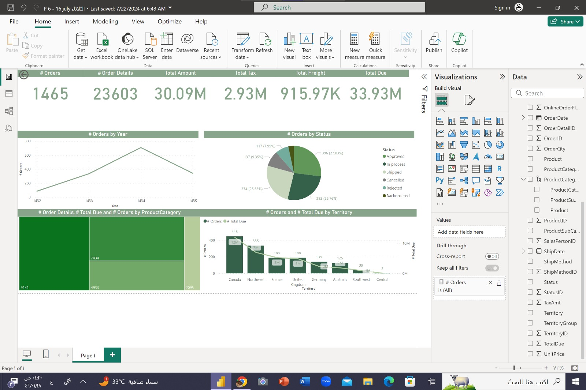
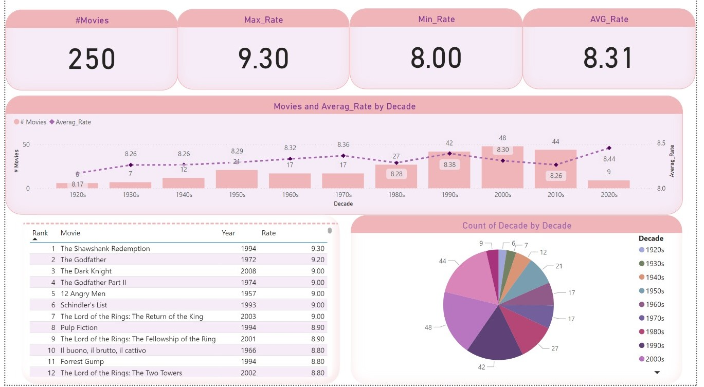

# POWER BI
### DATA ANALYTICS · DASHBOARD PORTFOLIO

**Transforming data into actionable insights through analytical reporting and visual storytelling.**

---

**01 — SALES & ORDERS** &nbsp; | &nbsp; **02 — MOVIE RATINGS**

## OVERVIEW

A portfolio of Power BI dashboards showcasing data analysis, KPI monitoring, performance evaluation, and interactive visualization across business and entertainment datasets.

The collection highlights two analytical applications: evaluating sales and order performance, and exploring movie ratings and historical trends.

---

## 01 / SALES & ORDERS ANALYTICS

**Business Intelligence · Sales Performance · Financial KPIs**

An analytical dashboard designed to examine sales operations, order activity, tax amounts, freight costs, and performance across territories and product categories.

### Performance Snapshot

| KEY METRIC | VALUE |
|:---|---:|
| Total Orders | 1,465 |
| Order Details | 23,603 |
| Total Amount | 30.09M |
| Total Tax | 2.93M |
| Total Freight | 915.97K |
| Total Due | 33.93M |

### Dashboard Preview

### Key Analytical Areas

- Annual order trends and volume comparisons
- Order status distribution and operational tracking
- Sales and financial performance across territories
- Product category analysis
- Tax, freight, and total due monitoring

**Project File:** [View Power BI Dashboard (.pbix)](Sales%20%26%20Orders%20Analytics%20Dashboard.pbix)

---

## 02 / MOVIE RATINGS ANALYSIS

**Movie Analytics · Rating Trends · Historical Comparisons**

A Power BI dashboard exploring 250 movies through ratings, rankings, decade-based comparisons, and historical rating trends.

### Performance Snapshot

| KEY METRIC | VALUE |
|:---|---:|
| Movies Analyzed | 250 |
| Highest Rating | 9.30 |
| Lowest Rating | 8.00 |
| Average Rating | 8.31 |

### Dashboard Preview

### Key Analytical Areas

- Movie rankings and individual ratings
- Average ratings across decades
- Movie distribution by release decade
- Historical rating comparisons
- Identification of rating patterns over time

---

## ANALYTICS WORKFLOW

`01 · DATA EXPLORATION` → `02 · DATA ANALYSIS` → `03 · KPI DEVELOPMENT` → `04 · VISUALIZATION` → `05 · INSIGHTS`

---

## TOOLS & COMPETENCIES

| AREA | APPLICATION |
|:---|:---|
| Business Intelligence | Microsoft Power BI |
| Data Analysis | Trend identification and comparative analysis |
| KPI Reporting | Performance indicators and analytical summaries |
| Data Visualization | Interactive charts, tables, and dashboards |
| Analytical Communication | Translating data into meaningful insights |

---

### BUILT WITH MICROSOFT POWER BI

**Data Analysis · Business Intelligence · Dashboard Development**

*Designed & Developed by Lama Al-Anazi*

